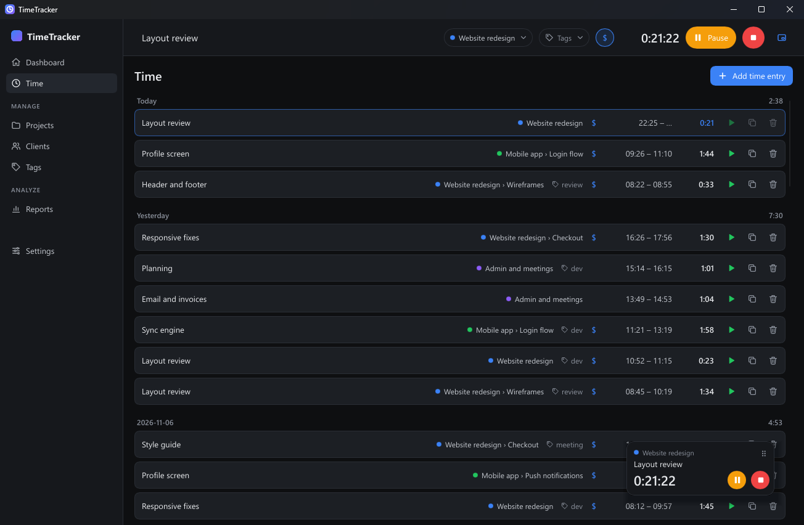
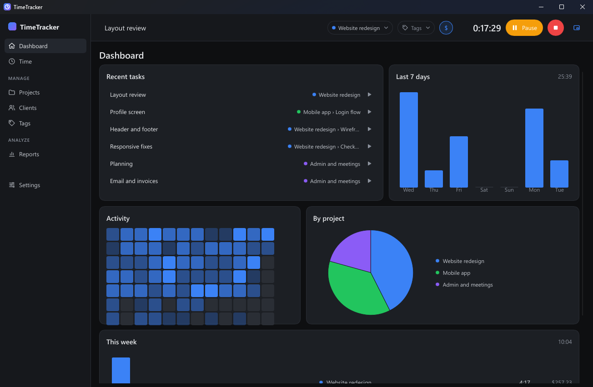
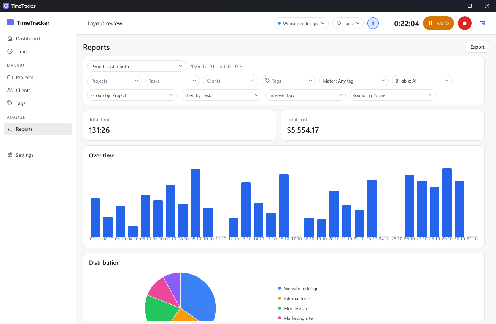
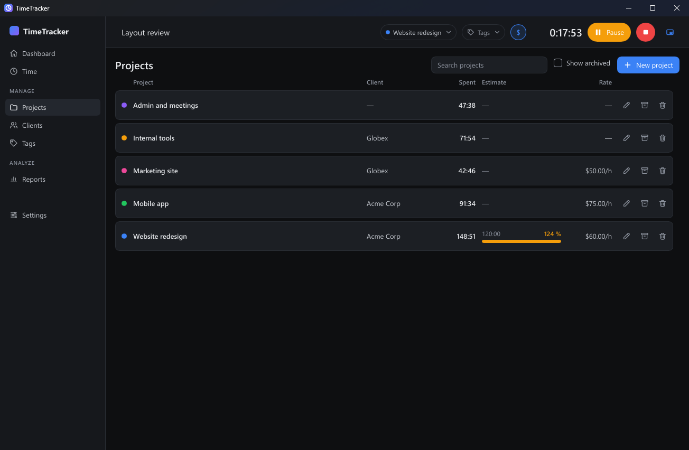
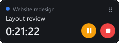

# TimeTracker

**An offline time tracker. No account, no server, no subscription. Your data stays on
your computer.**

English · [Русский](README.ru.md)

Track time per client, project and task. Pause the timer and resume it later, even the
next day. At the end of the month, export a report with hours and money per client.
Everything runs locally in a small native app.

## Why TimeTracker

- **Works offline, with no account.** Nothing to sign up for, nothing sent anywhere. The
  data is one SQLite file on your disk. You can back it up, restore it and export it.
- **Light and native.** No browser engine inside.
  - It starts in about 0.2 s.
  - In the tray with the timer running it uses about 4–6 MB of memory and practically no
    CPU ([measurements](docs/perf.md)).
- **A mini timer on top of other windows.** It is translucent until you move the mouse over
  it, and has pause and stop right there.
- **Honest days.** A pause may last overnight. An entry never crosses midnight, so every
  day gets exactly its own time.
- **Billing built in.** Hourly rates per project, with a default rate. Reports show time
  and cost and export to CSV and XLSX.
- **Four languages:** English, Russian, Spanish, Simplified Chinese
  ([add yours](docs/translating.md)).

## For freelancers

You work for several clients and need to bill each one exactly.

1. **Set up once.** Add a client, a project with its hourly rate, and a few tasks.
2. **Track.** Start the timer from the timer bar, the tray, the mini timer or the
   dashboard's recent tasks, and pause it for a break.
   - Forgot to start it? Add the entry by hand afterwards.
3. **Bill.**
   - Open Reports and pick the month.
   - Filter by client and group by project and task.
   - The total cost is there; export it to XLSX for the invoice.

## Leaving a cloud tracker

| | TimeTracker | Typical cloud tracker |
|---|---|---|
| Account | not needed | required |
| Works offline | always | limited or not at all |
| Where your data is | a file on your computer | the vendor's servers |
| Price | free, open source | free tier, paid plans |
| Teams, shared workspaces | no, it is a personal tool | yes |
| Sync between devices | planned, through a cloud folder of your choice | yes |
| Mobile app | no | usually |

Its behaviour is modelled on the core of [solidtime](https://www.solidtime.io/). It is not
affiliated with solidtime, and the code is our own.

## A quick tour

| | |
|---|---|
|  | **Dashboard.** Recent tasks to start in one click, the last 7 days, an activity heatmap, this week, and time by project. |
|  | **Reports** (here in the light theme). Period presets, filters, two grouping levels, bar and pie charts, rounding, and CSV and XLSX export. |
|  | **Projects, tasks, clients, tags.** Colors, hourly rates, time estimates with progress, and an archive. |
|  | **Mini timer.** Always on top, draggable, translucent until the mouse is over it. |

The tray icon shows whether the timer is running, paused or stopped. Its menu can pause,
stop, show the mini timer or open the window. Closing the window hides it to the tray.
On Linux a left click on the icon shows or hides the window. On macOS it is a menu bar icon, and a click opens its menu.

## Install

**Windows 10/11, 64-bit.** Download from the [latest release](https://github.com/OlegFM/timetracker/releases/latest):

- **`TimeTracker-<version>-setup.exe`** installs for the current user only, without
  administrator rights.
  - It adds a Start menu shortcut.
  - Uninstalling keeps your data.
- **`TimeTracker-<version>-portable.zip`** contains just `tt-app.exe`, with no installation.

The files are not signed yet, so Windows SmartScreen may warn on the first start. Choose
**More info** → **Run anyway**.

**Linux: Ubuntu 22.04 and 24.04 with GNOME, 64-bit (x86_64).** Download from the
[latest release](https://github.com/OlegFM/timetracker/releases/latest). Two formats:

- **`TimeTracker-<version>-x86_64.AppImage`** needs no installation.
  - Make it executable: `chmod +x TimeTracker-*.AppImage`, or in the file manager open
    **Properties** and allow running it as a program.
  - Then double-click it, or run it from a terminal.
- **`timetracker_<version>_amd64.deb`** installs system-wide and adds TimeTracker to the
  applications menu: `sudo apt install ./timetracker_*_amd64.deb`.

The tray icon works out of the box on Ubuntu, which ships GNOME's "AppIndicator and
KStatusNotifierItem Support" extension turned on. On plain GNOME without that extension
there is no icon: the app still works, but the close button quits it instead of hiding it
(a running timer is stored in the database and keeps counting after you start the app
again). The AppImage also needs `libxkbcommon-x11-0`, which Ubuntu Desktop already has.

On Linux the app always runs through X11 or XWayland, also in a Wayland session, so the mini
timer can stay on top of other windows. Known quirks are in
[docs/known-issues.md](docs/known-issues.md).

**macOS 11 or newer, Apple Silicon and Intel.** Download
**`TimeTracker-<version>-macos-universal.dmg`** from the
[latest release](https://github.com/OlegFM/timetracker/releases/latest), open it and drag
TimeTracker to **Applications**. Run it from there, not from the disk image or from
Downloads: autostart needs a permanent location.

The app is not notarized by Apple (that costs USD 99 a year; the source code is open), so
macOS says on the first start that it cannot verify the developer. Open it once like this:

- **macOS 15 and newer:** try to open the app, then go to **System Settings** → **Privacy &
  Security** and click **Open Anyway**.
- **macOS 11–14:** right-click the app → **Open** → **Open**.
- **Or in Terminal:** `xattr -dr com.apple.quarantine /Applications/TimeTracker.app`

After that it opens normally. The app lives in the menu bar; the Dock icon shows only while
the main window is open. The update check is off on macOS. Known quirks are in
[docs/known-issues.md](docs/known-issues.md).

## Your data

| What | Windows | Linux | macOS |
|---|---|---|---|
| Database | `%APPDATA%\TimeTracker\timetracker.db` | `~/.local/share/TimeTracker/timetracker.db` | `~/Library/Application Support/TimeTracker/timetracker.db` |
| Logs (no descriptions or names) | `%LOCALAPPDATA%\TimeTracker\logs` | `~/.local/share/TimeTracker/logs` | `~/Library/Application Support/TimeTracker/logs` |

**Settings › Data** makes a backup copy and restores one. Before a restore, the current
database is kept as `timetracker.db.before-restore`, so a wrong restore can be undone.

## Roadmap

- Sync between devices through a cloud folder (OneDrive, Dropbox, Google Drive…), with no
  server ([idea](docs/ideas/cloud-sync.md)).
- macOS notarization, once donations cover the Apple Developer fee ([idea](docs/ideas/cross-platform.md)).
- Microsoft Store release, signed by Microsoft ([idea](docs/ideas/msix-store.md)).

## Support the project

TimeTracker is free. If it saves you time, you can support its development:

- **In rubles** (cards of Russian banks, SBP): [CloudTips](https://pay.cloudtips.ru/p/96e84e4f)
- **International supporters: USDT** (a US-dollar stablecoin). Send only on the network
  shown next to the address; USDT sent on another network is lost.

  | Network | Address |
  |---|---|
  | **TON** | `UQC2hp29_K1erL9o_bv-c9ws0bj_VUfiYwLO3B108UF5MIPa` |
  | **Tron (TRC-20)** | `TJ4EjQgUrhLEwbHwoNEmr4Hh11jwumPv1h` |

## Contributing

Bug reports and ideas are welcome in [Issues](https://github.com/OlegFM/timetracker/issues).
To build from source, run the tests or add a translation, see
[docs/development.md](docs/development.md).

Written in Rust with [Slint](https://slint.dev).

## License

[GNU AGPL-3.0-only](LICENSE).

The UI is built with [Slint](https://slint.dev) under the Slint Royalty-free License 2.0
(attribution in Settings › About). Third-party crate licenses are checked with
`cargo deny` (`deny.toml`).
