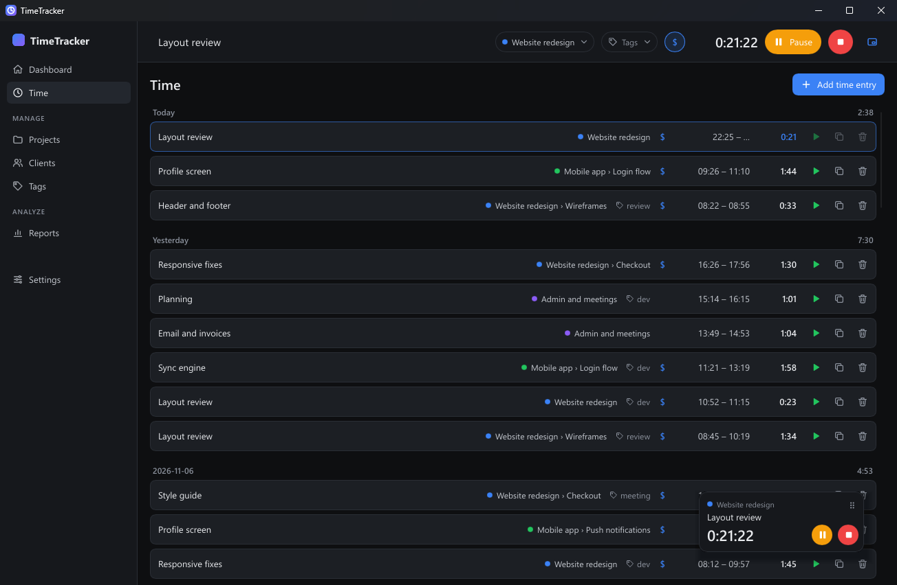
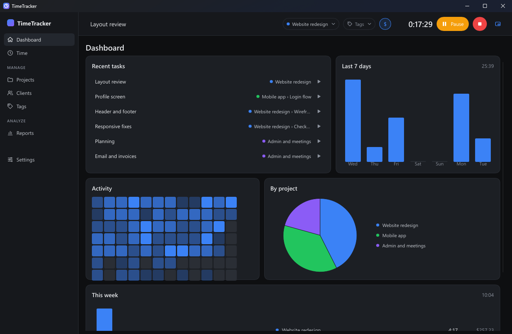
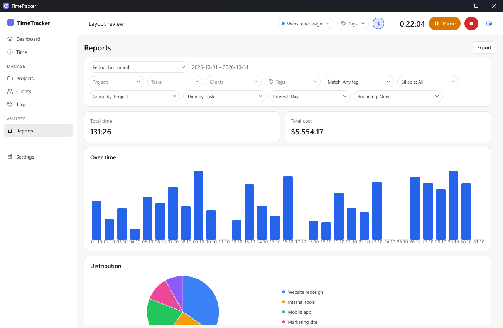
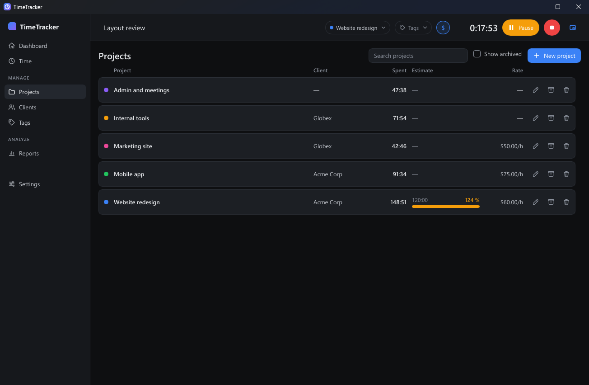

# TimeTracker

**Офлайн-трекер времени. Без аккаунта, без сервера, без подписки. Ваши данные остаются
на вашем компьютере.**

[](https://github.com/OlegFM/timetracker/releases/latest)
[](LICENSE)


[English](README.md) · Русский



Учитывайте время по заказчикам, проектам и задачам. Ставьте таймер на паузу и
продолжайте позже, хоть на следующий день. В конце месяца выгрузите отчёт с часами и
суммой по каждому заказчику. Всё работает локально, в небольшой нативной программе.

## Почему TimeTracker

- **Работает без интернета и без аккаунта.** Не нужно регистрироваться, ничего никуда не
  отправляется. Данные — один файл SQLite на вашем диске. Его можно сохранить в резервную
  копию, восстановить и выгрузить.
- **Лёгкий и нативный.** Внутри нет браузерного движка.
  - Запускается примерно за 0,2 с.
  - В трее с идущим таймером занимает около 4–6 МБ памяти и почти не нагружает процессор
    ([замеры](docs/perf.md)).
- **Мини-таймер поверх окон.** Он полупрозрачный, пока на него не наведена мышь, и пауза
  со стопом — прямо на нём.
- **Честные дни.** Пауза может длиться всю ночь. Запись никогда не переходит через
  полночь, поэтому каждому дню достаётся ровно его время.
- **Учёт оплаты.** Почасовые ставки по проектам и ставка по умолчанию. Отчёты показывают
  время и стоимость и выгружаются в CSV и XLSX.
- **Четыре языка:** английский, русский, испанский, упрощённый китайский
  ([добавить свой](docs/translating.md)).

## Для фрилансера

Вы работаете на нескольких заказчиков, и каждому нужно выставить точный счёт.

1. **Один раз настройте.** Добавьте заказчика, проект с почасовой ставкой и несколько
   задач.
2. **Учитывайте время.** Запускайте таймер из строки таймера, трея, мини-таймера или из
   недавних задач на «Обзоре». На перерыв ставьте его на паузу.
   - Забыли включить? Добавьте запись вручную задним числом.
3. **Выставьте счёт.**
   - Откройте «Отчёты» и выберите месяц.
   - Отфильтруйте по заказчику и сгруппируйте по проекту и задаче.
   - Итоговая стоимость уже посчитана; выгрузите её в XLSX для счёта.

## Если уходите с облачного трекера

| | TimeTracker | Обычный облачный трекер |
|---|---|---|
| Аккаунт | не нужен | обязателен |
| Работа без интернета | всегда | ограниченно или никак |
| Где ваши данные | в файле на вашем компьютере | на серверах сервиса |
| Цена | бесплатно, открытый код | бесплатный тариф и платные |
| Команды, общие пространства | нет, это личный инструмент | есть |
| Синхронизация между устройствами | в планах, через облачную папку на ваш выбор | есть |
| Мобильное приложение | нет | обычно есть |

Поведение программы повторяет ядро [solidtime](https://www.solidtime.io/). С solidtime
проект не связан, код написан с нуля.

## Коротко об экранах

| | |
|---|---|
|  | **Обзор.** Недавние задачи для запуска в один клик, последние 7 дней, карта активности, эта неделя и время по проектам. |
|  | **Отчёты** (здесь в светлой теме). Готовые периоды, фильтры, два уровня группировки, столбчатые и круговые диаграммы, округление, выгрузка в CSV и XLSX. |
|  | **Проекты, задачи, заказчики, теги.** Цвета, почасовые ставки, оценки времени с прогрессом и архив. |
|  | **Мини-таймер.** Всегда поверх окон, перетаскивается, полупрозрачный, пока на него не наведена мышь. |

Значок в трее показывает, идёт таймер, стоит на паузе или остановлен. Через его меню
можно поставить паузу, остановить таймер, показать мини-таймер или открыть окно.
Закрытое окно прячется в трей.

## Установка

**Windows 10/11, 64 бита.** Скачайте файлы из [последнего релиза](https://github.com/OlegFM/timetracker/releases/latest):

- **`TimeTracker-<версия>-setup.exe`** устанавливает программу только для текущего
  пользователя, без прав администратора.
  - Добавляет ярлык в меню «Пуск».
  - При удалении ваши данные сохраняются.
- **`TimeTracker-<версия>-portable.zip`** содержит только `tt-app.exe`, без установки.

Файлы пока не подписаны, поэтому при первом запуске Windows SmartScreen может показать
предупреждение. Нажмите **Подробнее** → **Выполнить в любом случае**.

**macOS и Linux** — сборки скоро ([план](docs/ideas/cross-platform.md)).

## Ваши данные

| Что | Где |
|---|---|
| База данных | `%APPDATA%\TimeTracker\timetracker.db` |
| Логи (без описаний и названий) | `%LOCALAPPDATA%\TimeTracker\logs` |

**Настройки › Данные** создают резервную копию и восстанавливают её. Перед
восстановлением текущая база сохраняется как `timetracker.db.before-restore`, так что
ошибочное восстановление можно отменить.

## Планы

- Синхронизация между устройствами через облачную папку (OneDrive, Dropbox, Google Drive…)
  без сервера ([идея](docs/ideas/cloud-sync.md)).
- Сборки для macOS и Linux ([идея](docs/ideas/cross-platform.md)).
- Выпуск в Microsoft Store с подписью Microsoft ([идея](docs/ideas/msix-store.md)).

## Поддержать проект

TimeTracker бесплатный. Если он экономит вам время, вы можете поддержать разработку:

- **Рублями** (карты российских банков, СБП): [CloudTips](https://pay.cloudtips.ru/p/96e84e4f)
- **Криптовалютой:** USDT только в сети **TON**:

  ```
  UQC2hp29_K1erL9o_bv-c9ws0bj_VUfiYwLO3B108UF5MIPa
  ```

## Участие

Ошибки и идеи пишите в [Issues](https://github.com/OlegFM/timetracker/issues). Как
собрать программу из исходников, запустить тесты или добавить перевод, описано в
[docs/development.md](docs/development.md) (на английском).

Написано на Rust со [Slint](https://slint.dev).

## Лицензия

[GNU AGPL-3.0-only](LICENSE).

Интерфейс построен на [Slint](https://slint.dev) по лицензии Slint Royalty-free License 2.0
(упоминание в «Настройки › О программе»). Лицензии сторонних библиотек проверяются через
`cargo deny` (`deny.toml`).
